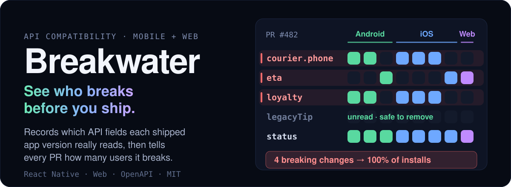
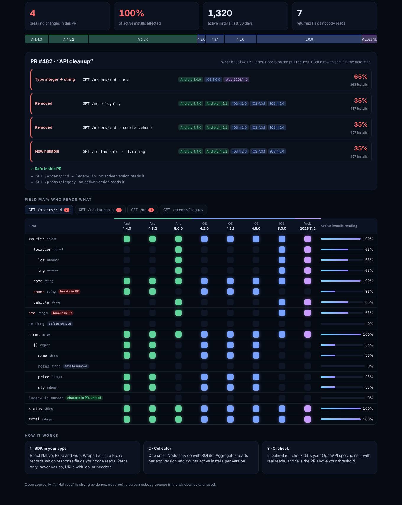
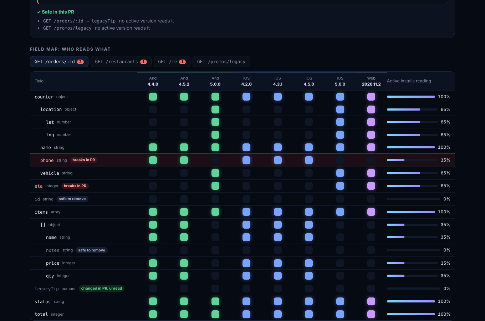
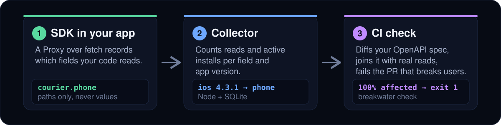

<h1 align="center">
  
</h1>

<p align="center">
  <a href="https://github.com/QasimJaffry/breakwater/actions/workflows/ci.yml"></a>
  
  
</p>

Breakwater is a small SDK, a collector and a CI check. The SDK records which API response fields each shipped version of your mobile and web apps *actually reads*. On every pull request, the CLI joins that with your OpenAPI diff and tells you which app versions, and how many real installs, an API change will break.



*Demo: simulated traffic from the example "Eats" app, measured by the real SDK and collector.*

## Try it in 30 seconds

```bash
git clone https://github.com/QasimJaffry/breakwater && cd breakwater
npm install && npm run demo     # simulated app fleet → real SDK → real collector → PR report
```

It prints the PR report above and writes `dist/dashboard.html`: open it in a browser to click through the field map. Needs Node 22+.

## The problem

You can redeploy a backend in minutes. You cannot redeploy the app on your users' phones. A real share of every mobile install base runs versions that are months old, so renaming a field, removing one, or letting it become `null` silently breaks people you can't see.

Schema diff tools (OpenAPI diff, BreakShield, the now-archived Optic) tell you a change is *structurally* breaking. They can't tell you whether anyone still depends on it, so teams either keep dead fields forever or ship and hope. The usual advice is "measure actual usage before removing anything". Breakwater is that measurement, per field and per app version.

## What it looks like on a PR

```
### 🌊 Breakwater: 4 breaking changes reach 100% of active installs (1,320 of 1,320)

| Change                          | Field                              | Read by                                     | Installs  |
| Type changed (integer → string) | GET /orders/:* → eta               | android 5.0.0; ios 5.0.0; web 2026.11.2     | 863 (65%) |
| Removed                         | GET /me → loyalty                  | android 4.4.0–4.5.2; ios 4.2.0–4.5.0        | 457 (35%) |
| Removed                         | GET /orders/:* → courier.phone     | android 4.4.0–4.5.2; ios 4.2.0–4.5.0        | 457 (35%) |
| Now nullable                    | GET /restaurants → [].rating       | android 4.4.0–4.5.2; ios 4.2.0–4.5.0        | 457 (35%) |

2 other changes touch fields no active version read in the last 30 days:
- Removed: GET /orders/:* → legacyTip
- Endpoint removed: GET /promos/legacy
```

This is real output from `npm run demo` (see [the demo](#run-the-demo)): the "cleanup" PR looked harmless, but it breaks every user. Old versions still call the courier, show loyalty points and render star ratings, and the new version parses `eta` as a number.



## How it works

<p align="center">
  
</p>

1. **SDK** (`@breakwater/react-native`, `@breakwater/web`, shared `@breakwater/core`). It wraps `fetch` so `response.json()` returns a [Proxy](https://developer.mozilla.org/docs/Web/JavaScript/Reference/Global_Objects/Proxy) over the parsed body. Reading `order.courier.phone` records the path `courier.phone`, and array elements collapse to `items[].price`. Spread, destructuring, `JSON.stringify`, `for…of` and array methods all work and are recorded. Reads are deduplicated per route, so after warm-up a session sends nothing new.
2. **Collector** (`@breakwater/collector`). A small Node service with SQLite (`node:sqlite`, no native deps). It validates every report strictly, stores `(route, path, platform, version)` with last-seen times, and counts active installs per version.
3. **CLI** (`@breakwater/cli`). `breakwater check` flattens the old and new OpenAPI response schemas (handling `$ref`, `allOf`/`oneOf`/`anyOf`, 3.0 and 3.1 nullability, recursive schemas), finds breaking response changes (removed fields and endpoints, widened types, newly nullable, newly optional), and joins them with real reads. Reading a parent object in bulk counts as reading its children. It exits non-zero above `--fail-above`. `breakwater unused` lists fields nobody reads.

## Privacy by construction

What leaves the device is a list of field **paths** per route template, plus the app version, platform and a random install id:

```json
{ "app": { "version": "4.3.1", "platform": "ios" }, "installId": "3f…", "routes": { "GET /orders/:id": ["courier.name", "courier.phone", "items[].price"] } }
```

No values, no headers, no query strings, no ids in URLs (`/orders/8812` becomes `/orders/:id`), no user identifiers. A test asserts that values never appear in a report.

## Use it

React Native / Expo:

```ts
import { AppState, Platform } from "react-native";
import AsyncStorage from "@react-native-async-storage/async-storage";
import * as Application from "expo-application";
import { initBreakwater } from "@breakwater/react-native";

export const bw = await initBreakwater({
  endpoint: "https://breakwater.example.com",
  app: { version: Application.nativeApplicationVersion!, platform: Platform.OS },
  appState: AppState,
  storage: AsyncStorage,
  filter: (url) => url.startsWith("https://api.example.com"),
});

const order = await (await bw.fetch(`https://api.example.com/orders/${id}`)).json();
```

Web: `initBreakwater` from `@breakwater/web` (flushes with `sendBeacon` on page hide). Using axios, GraphQL or websockets? Call `bw.observe(method, url, parsedJson)`.

Collector: `PORT=4319 BREAKWATER_DB=./bw.db BREAKWATER_INGEST_KEY=… BREAKWATER_READ_KEY=… node packages/collector/dist/server.js`

CI: see [`examples/github-action/breakwater.yml`](examples/github-action/breakwater.yml).

## Run the demo

```bash
npm install
npm test          # 55 tests: proxy semantics, routes, client, collector (incl. HTTP), OpenAPI diff, impact, CLI
npm run demo      # simulated "Eats" app fleet → real SDK → real collector over HTTP → CI report + dist/dashboard.html
```

The demo simulates 8 app versions across iOS, Android and web. Each version's "screens" are ordinary code that reads the fields that version's UI needs, running against a fake API through the real SDK and an in-process collector. The install counts and which screens each simulated user opens are made up (seeded, reproducible). Every number in the report is computed by Breakwater from the reads it observed.

## Limits (read before trusting a green check)

- **"Not read" is evidence, not proof.** A screen nobody opened during the window looks unused. Use a window that covers your release cycle, and keep a sample rate of 1 for small apps.
- **Only reads through tracked responses count.** Values copied into your own state and read later are covered, because the copy happens through the Proxy. Data your server renders or your backend consumes is not.
- **Proxies are not cloneable.** `structuredClone`/`postMessage` of a tracked body throws, so call `unwrap(value)` first. Tracked objects are not `===` the raw parsed object, but they are stable across reads.
- **Active installs are installs that reported in the window**, not store-reported installs.
- Response-side changes only. Request-side changes (new required parameters) are a planned follow-up.

## Layout

```
packages/core          tracking Proxy, route templates, recorder, fetch wrapper, client
packages/web           browser preset (localStorage id, sendBeacon)
packages/react-native  RN/Expo preset (AppState, AsyncStorage); Hermes supports Proxy
packages/collector     HTTP ingest + snapshot, SQLite store, strict validation
packages/cli           OpenAPI flattening, diff, impact, Markdown report, `check` / `unused`
apps/dashboard         field × version map (static, built by `npm run demo`)
examples/eats          demo API specs (main and PR #482)
```

MIT licensed.
